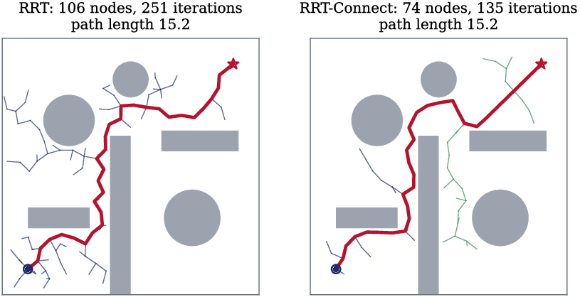
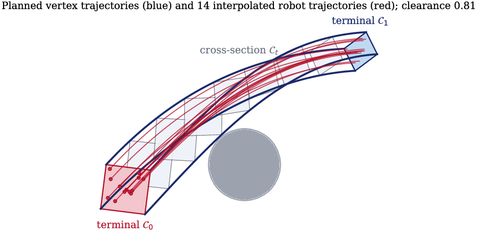
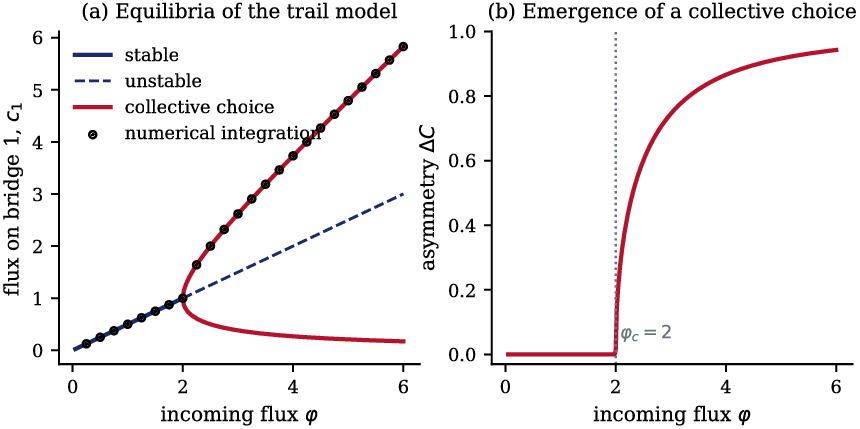
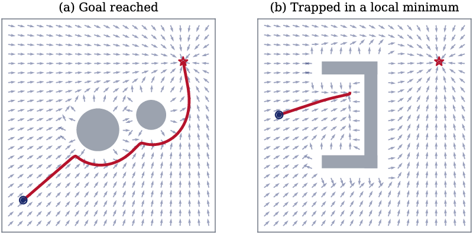

<h1 align="center">Swarm-Path-Planning-Survey</h1>

<p align="center">
  A survey of path planning methods for swarm robots, from ant colonies and
  particle swarms to sampling-based planners, reinforcement learning and
  virtual tubes, with Python code that reproduces the planner figures.
  <br>
  The extended edition of my MSc seminar in Electrical Engineering (Control) at
  <a href="https://www.iust.ac.ir/">Iran University of Science and Technology</a>.
</p>

<p align="center">
  
  
  
  
  
</p>

<p align="center">
  
  &nbsp;
  
</p>

<p align="center"><sub>
  Left: RRT and RRT-Connect with the same seed and step size. Right: a linear
  virtual tube, where only the four vertex trajectories are planned and every
  robot follows an interpolation of them. Both are generated by
  <code>figures/src/</code>.
</sub></p>

<p align="center">
  <a href="report/Swarm-Path-Planning-Survey.pdf"><b>Read the report (PDF)</b></a>
  ·
  <a href="READING_LIST.md"><b>Reading list</b></a>
</p>

---

## What it is

Path planning is hard enough for one robot. In a swarm it also has to scale to
hundreds of robots that only see and talk to their neighbors, keep working when
some of them fail, and stay cheap enough to run on small embedded computers. This
report reviews how the field approaches that problem, and why the methods that
work for a single robot often stop working for a swarm.

I wrote the first version for my MSc seminar (supervisor: Dr. Mohammad Farrokhi,
Azar 1404 / December 2025). The seminar format forced me to cut a lot of
material, so this edition puts it back: hierarchical control architectures,
other swarm-intelligence algorithms, roadmap-based flocking, the formal theory of
virtual tubes, ten application areas and a chapter of future research
directions. The text is in English.

## Contents

| Chapter | Pages | What it covers |
|---|---|---|
| 1. Introduction | 1–8 | What makes a robot team a swarm, why path planning is harder for swarms (complexity, energy, faults, moving targets). |
| 2. Fundamental concepts | 9–25 | Self-organization and stigmergy (including the trail-choice bifurcation), decentralized, hierarchical, behavior-based and hybrid control, virtual linkages, communication and sensing, and the basics of path planning. |
| 3. Path planning algorithms | 26–49 | ACO, PSO and MOPSO, bee algorithms and seven other swarm metaheuristics; PRM, RRT, A\*, cell decomposition and Voronoi roadmaps; potential fields; RL, deep RL, SAC and imitation learning; hybrids; optimal virtual tubes. |
| 4. Challenges and applications | 50–63 | Collision avoidance (APF, ORCA, BVC), dynamic environments, scalability and fault tolerance, task allocation and cooperative transport, and applications in search and rescue, monitoring, agriculture, space, medicine, security, logistics and surveillance. |
| 5. Summary and future work | 64–69 | A comparison of deterministic, AI-based and hybrid planners, and open directions: learning, human–swarm interaction, hardware and simulation, ethics. |

The report has 18 figures, 2 tables and 116 references. All references were
checked against the papers themselves.

## Figures you can reproduce

Ten figures are produced by the scripts in [`figures/src/`](figures/src); the
other eight are TikZ drawings in [`report/figures/tikz/`](report/figures/tikz).
Each script also checks its own result.

| Script | Figure | What it checks |
|---|---|---|
| `astar_grid.py` | A\* vs. Dijkstra on a grid | both return the same optimal cost (21.00); A\* expands 133 cells instead of 359 |
| `sampling_planners.py` | PRM, and RRT vs. RRT-Connect | RRT-Connect needs 135 iterations instead of 251 for the same workspace |
| `voronoi_roadmap.py` | GVD roadmap through a narrow door | the path follows the maximum-clearance roadmap |
| `potential_field.py` | potential field with a local minimum | one run reaches the goal, the other gets stuck in a U-shaped trap |
| `pso_path.py` | PSO waypoint optimization | convergence of the best cost |
| `swarm_models.py` | trail-choice bifurcation, double bridge, leader–follower | equilibria match numerical integration; bifurcation at φ = 2; formation error < 0.05 |
| `virtual_tube.py` | linear virtual tube | interpolated trajectories keep a positive clearance from the obstacle |

<p align="center">
  
  &nbsp;
  
</p>

## How to build

**Figures** (Python 3.10+):

```bash
pip install -r figures/src/requirements.txt
python figures/src/make_figures.py
```

**Report** (any TeX distribution with pdfLaTeX, biber and the `newpx`,
`classico` and TikZ packages; tested with MiKTeX):

```bash
cd report
latexmk
```

`latexmk` reads `.latexmkrc` and runs pdfLaTeX and biber as needed. The built
PDF is also committed as
[`report/Swarm-Path-Planning-Survey.pdf`](report/Swarm-Path-Planning-Survey.pdf).

## The original proposal

[`docs/proposal-fa.pdf`](docs/proposal-fa.pdf) is the seminar proposal I
submitted in Khordad 1404 (June 2025), in Persian. It frames swarm path planning as
a set of coupled challenges (many robots, limited sensing and communication,
dynamic environments, energy) and lists the families of methods the seminar set
out to review: distributed consensus and formation control, machine and
multi-agent reinforcement learning, swarm optimization (PSO, ACO), optimal and
model predictive control, graph theory for the communication structure,
sampling-based planners (PRM, RRT), and combinations of these. It argues that no
single family is enough and that a complete solution has to combine several of
them, which is the conclusion this report also reaches.

## Repository layout

```
Swarm-Path-Planning-Survey/
├── README.md
├── READING_LIST.md            sources grouped by topic
├── report/
│   ├── main.tex               preamble and document structure
│   ├── chapters/              one file per chapter
│   ├── frontmatter/           title page, abstract, abbreviations
│   ├── figures/               generated PDFs, tikz/ sources, IUST logo
│   ├── references.bib
│   └── Swarm-Path-Planning-Survey.pdf
├── figures/src/               Python scripts for the data figures
├── docs/proposal-fa.pdf       original seminar proposal (Persian)
└── media/                     PNG previews for this README
```

## Author

**Arshia Goshtasbi**, MSc student in Electrical Engineering (Control), Iran
University of Science and Technology. Supervisor: Dr. Mohammad Farrokhi.

## License

The report text and figures are licensed under
[CC BY 4.0](LICENSE-CC-BY-4.0); the code in `figures/src/` is licensed under
[MIT](LICENSE). The IUST logo on the title page belongs to the university.
